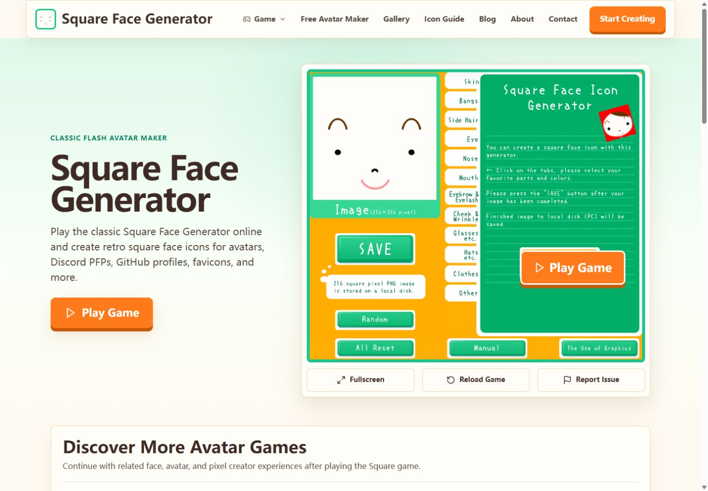
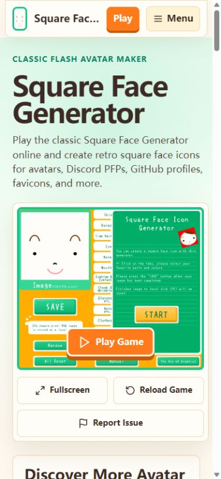

# HOME-HERO-001 implementation evidence

Date: 2026-09-01  
Task status: implemented locally, awaiting user acceptance  
Affected production URL: `/`  
Release status: blocked; no commit, push, deployment, or production SEO verification was performed

## Accepted source

- Proposal: `docs/product/home-hero-and-core-entry-proposal.md`
- User confirmation: `确认 HOME-HERO-001 方案，进行开发`
- Accepted concepts: `docs/product/concepts/home-hero-001-desktop-concept.png` and `docs/product/concepts/home-hero-001-mobile-concept.png`

## Visual evidence

The production render was compared directly with both accepted concepts after implementation. The copy, two-column desktop hierarchy, single-column mobile hierarchy, mint/cream/brown/green/orange palette, real Square cover, stable player frame, control order, and discovery transition match the approved direction. No intentional material deviation remains.

## Browser evidence

Tests used the Codex in-app Browser against the local Next development server.

- `1440 x 1000`: one H1, one `RUFFLE_SWF` player shell, two desktop columns (`453.328px / 709.078px`), Hero CTA visible, no initial `ruffle-player`, and no framework error overlay.
- `1280 x 900`: two columns remain (`423.453px / 662.359px`), one player shell, Hero CTA visible, and no initial runtime.
- `390 x 844`: actual content viewport `375 x 844`; document width equals content width, so no horizontal overflow. H1 occupies two lines; copy, preview, cover Play, and all three controls are visible in the first viewport. The duplicate Hero CTA is hidden and the controls use the approved `2 + 1` layout.
- Initial desktop console capture was empty. The initial DOM contained no Ruffle, WASM, SWF, object, or embed runtime node.
- Desktop Hero `Play Game` activated the same player shell: player count remained `1` and `ruffle-player` changed from `0` to `1`.
- `Reload Game` retained one player shell and one runtime instance. `Report Issue` resolves to `/contact`.
- Mobile cover `Play Game` also changed `ruffle-player` from `0` to `1` while player count and document width remained stable.
- Visual QA found that the old generic hover rule moved the desktop cover CTA about `107px` left. A Home-player-scoped rule was added; the repeated browser measurement showed `0px` horizontal shift. Mobile default and hover center deltas both measured `0px`.
- The Fullscreen control was present and its click handler was exercised, but the in-app browser did not establish `document.fullscreenElement`; this item is classified as unverified in that browser environment, not as a verified production success.

## Automated checks

Passed:

- `npm run home-hero:check`
- `npm run home:check`
- `npm run metadata:check`
- `npm run games:check`
- `npm run player:check`
- `npm run routes:check`
- `npm run components:check`
- `npx tsc -p tsconfig.home-hero-check.json --noEmit`
- scoped ESLint for the changed Hero/player/check files
- `git diff --check`

Blocked by the preserved malformed first line in `app/sitemap.ts` (`SHA-256 B21AEF365B81499147B4DAAF12F11A6802402D391185CD85E27E8BB6B34CEDD9`):

- `npm run lint`
- `npm run build`
- `npm run cf:build`

`npm run seo:check` was not run because a local production build could not be produced. `npm run seo:prod` was not run because deployment was not authorized.

## Preserved blockers and rollback

The task does not change or close the malformed sitemap source, HTTP-root redirect failure, mobile Lighthouse LCP `4.6s`, Square/Oval `UNKNOWN` exact-license evidence, or three mandatory KW-02 probe findings.

Rollback is code-only: restore the prior root-home branch in `components/HomePage.tsx`, remove `HomeHero` and `CoreGamePreview`, remove the HOME-HERO scoped CSS/check files and package command, and revert the ref forwarding added to `FlashGenerator`/`GamePlayer`. Game Data, SWF assets, routes, metadata, canonical/index state, and deployment state require no data rollback.
